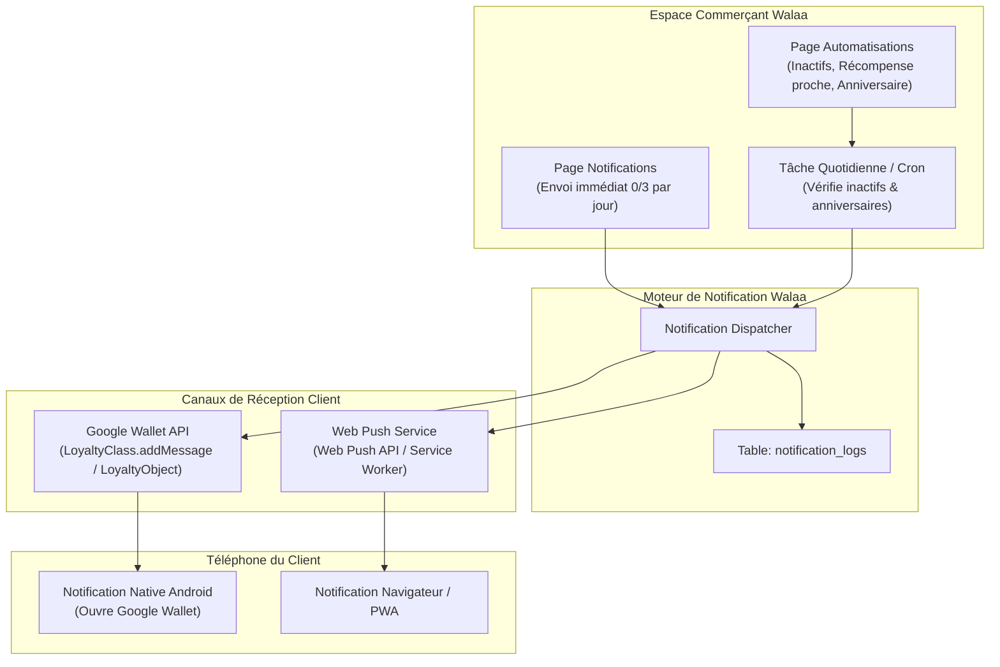

# Plan d'Architecture & d'Implémentation : Google Wallet, Notifications Push & Automatisations

Ce document constitue la feuille de route complète pour l'intégration de **Google Wallet**, du système de **Notifications Manuelles (Broadcast Push)** et du moteur d'**Automatisations Intelligentes** dans Walaa, sur la base des maquettes et flux validés (`loyalty-planning/wallet`).

---

## 1. Validation Google & Évolutivité Post-Validation

### Google exige-t-il une nouvelle validation lorsqu'on ajoute de nouvelles fonctionnalités ?
> [!IMPORTANT]
> **NON, aucune re-validation n'est requise.**
> L'approbation de Google est accordée au niveau de l'**Émetteur (Issuer ID: `3388000000023206839`)** et non pas au niveau du code de votre application.
> 
> Une fois que Google valide votre compte et active le **Mode Production** :
> 1. Vous pouvez ajouter des notifications manuelles, des campagnes push, des automatisations, des nouveaux champs sur la carte, de nouveaux paliers de récompense **à tout moment via l'API**, sans jamais devoir redemander l'accord de Google.
> 2. Vos appels à l'API Google Wallet (`messages`, `patch`, `update`) sont instantanés.
> 3. La validation initiale n'est qu'une vérification d'identité et de respect de la charte graphique de base (bouton officiel et pass lisible).

---

## 2. Analyse des Maquettes de Référence (`loyalty-planning/wallet`)

### 2.1 Carte Client (`/c/[token]`) & Boutons Wallet
*D'après `gofullpage-fidelix-ma-card-...png` :*
1. **Bannière d'opt-in aux notifications :**
   - Bloc noir contrasté : *"NOTIFICATIONS : NE RATEZ AUCUNE OFFRE"*
   - Texte : *"Promotions, récompenses débloquées, invitations : recevez tout directement sur votre téléphone."*
   - Bouton CTA : `[ Activer les notifications ]` (Web Push).
2. **Section "AJOUTER À VOTRE WALLET" :**
   - **Bouton Apple Wallet :** Bouton noir aux coins arrondis *"Ajouter à Apple Wallet"* avec logo officiel Apple (prêt pour la phase Apple Wallet).
   - **Bouton Google Wallet :** Bouton élégant avec le logo officiel Google Wallet et le texte *"Ajouter à Google Wallet"*.
3. **Sections complémentaires :**
   - Bloc "Mon Compte" (Code client, date d'adhésion).
   - Bloc "Parrainage : Invitez un ami" (Partage de lien unique).

---

### 2.2 Dashboard Commerçant : Notifications Push Manuelles (`/dashboard/notifications`)
*D'après `gofullpage-fidelix-ma-notifications-...png` :*
* **Quota anti-spam journalier :** Badge `0/3 aujourd'hui` (*"Jusqu'à 3 notifications par jour. Au-delà, les clients se lassent et suppriment leur carte"*).
* **Formulaire d'envoi rapide :**
  - **Titre (0/50 caractères) :** ex. *"Offre spéciale ce weekend !"*
  - **Message (0/150 caractères) :** ex. *"Profitez de -20% sur votre prochaine visite. Valable jusqu'au 30 juin."*
  - **Lien optionnel (URL cliquable) :** ex. `https://votre-site.ma/offre`.
* **Avertissement de conformité :** Modération de contenu (anti-spam / respect des règles).
* **Historique des campagnes :** Tableau listant les notifications envoyées (Date, Titre, Message, Nombre de destinataires, Statut).
* **Diffusion Multi-Canal :**
  - Envoi via **Google Wallet API** (`messages.add` avec `messageType: "TEXT_AND_NOTIFY"` sur la `LoyaltyClass`). Tous les détenteurs du pass reçoivent une notification système Android native qui ouvre directement le pass Google Wallet !
  - Envoi simultané via **Web Push** pour les clients abonnés sur le navigateur.

---

### 2.3 Dashboard Commerçant : Automatisations Intelligentes (`/dashboard/automatisations`)
*D'après `gofullpage-fidelix-ma-automations-...png` :*
*Des messages programmés envoyés automatiquement pour faire revenir les clients sans effort du commerçant :*

1. **Relance client inactif (Win-back) :**
   - Switch On/Off.
   - Message personnalisable : *"Cela fait un moment ! Revenez profiter de vos avantages fidélité. 😊"*
   - Déclencheur paramétrable : *"Après [ 30 ] jours sans visite"*.
2. **Bientôt une récompense (Proximity reward) :**
   - Switch On/Off.
   - Message automatique calculé par le système.
   - Déclencheur paramétrable : *"Notifier quand il reste [ 20 ] points (ou X tampons) avant la récompense"*.
3. **Anniversaire (Birthday delight) :**
   - Switch On/Off.
   - Message personnalisable : *"Joyeux anniversaire ! Une attention vous attend chez nous. 🎂"*
   - Déclencheur : *"Envoyer [ 0 ] jour même"* (ou la veille).
   - Collecte de la date d'anniversaire facultative sur le formulaire client `/j/[slug]`.
* **Règle de protection :** Un même client n'est jamais contacté deux fois pour le même événement déclencheur.

---

## 3. Architecture Technique & Flux de Données



---

## 4. Modèle de Données (Drizzle Schema)

Pour supporter ces fonctionnalités, nous ajouterons les tables suivantes dans `src/db/schema/loyalty.ts` :

```typescript
// 1. Configuration des automatisations par commerce
export const automations = pgTable("automations", {
  id: text("id").primaryKey(),
  organizationId: text("organization_id").notNull().references(() => organization.id, { onDelete: "cascade" }),
  type: text("type").notNull(), // 'inactive_client' | 'reward_proximity' | 'birthday'
  isEnabled: boolean("is_enabled").default(false).notNull(),
  message: text("message").notNull(),
  triggerValue: integer("trigger_value").notNull(), // ex: 30 (jours) ou 20 (points restants)
  createdAt: timestamp("created_at").defaultNow().notNull(),
  updatedAt: timestamp("updated_at").defaultNow().notNull(),
});

// 2. Historique des notifications manuelles et automatiques
export const notifications = pgTable("notifications", {
  id: text("id").primaryKey(),
  organizationId: text("organization_id").notNull().references(() => organization.id, { onDelete: "cascade" }),
  title: text("title").notNull(),
  message: text("message").notNull(),
  actionUrl: text("action_url"),
  type: text("type").default("manual").notNull(), // 'manual' | 'automation'
  channel: text("channel").default("all").notNull(), // 'wallet' | 'webpush' | 'all'
  recipientCount: integer("recipient_count").default(0).notNull(),
  sentAt: timestamp("sent_at").defaultNow().notNull(),
});

// 3. Journal d'envoi par client (pour éviter les doublons de relance)
export const notificationLogs = pgTable("notification_logs", {
  id: text("id").primaryKey(),
  customerId: text("customer_id").notNull().references(() => customers.id, { onDelete: "cascade" }),
  automationType: text("automation_type").notNull(),
  sentAt: timestamp("sent_at").defaultNow().notNull(),
});
```

---

## 5. Intégration de l'API Google Wallet pour les Notifications Push

Google Wallet permet d'envoyer des notifications push instantanées via la méthode `addMessage` :

### Envoi d'une notification à tous les détenteurs de la carte (Broadcast) :
```typescript
await walletClient.loyaltyclass.addMessage({
  resourceId: `${ISSUER_ID}.program_${programId}`,
  requestBody: {
    message: {
      header: title,
      body: messageText,
      actionUrl: linkUrl ? { url: linkUrl } : undefined,
      messageType: "TEXT_AND_NOTIFY", // Déclenche la notification push native Android !
      displayInterval: {
        start: { date: new Date().toISOString() },
        end: { date: new Date(Date.now() + 7 * 86400000).toISOString() },
      },
    },
  },
});
```

### Envoi d'une notification ciblée à un client spécifique (Automatisations / Récompense) :
```typescript
await walletClient.loyaltyobject.addMessage({
  resourceId: `${ISSUER_ID}.card_${cardId}`,
  requestBody: {
    message: {
      header: "Bientôt votre cadeau !",
      body: "Plus que 2 tampons pour obtenir votre café offert ☕",
      messageType: "TEXT_AND_NOTIFY",
    },
  },
});
```

---

## 6. Plan de Déploiement Étape par Étape

### Phase 1 : Cœur Google Wallet (Mode Démo)
1. Installation du package `googleapis`.
2. Création de la couche Google Wallet (`src/lib/wallet/google/`) :
   - `client.ts` (Authentification Service Account)
   - `class.ts` (Création de la classe visuelle du commerce)
   - `object.ts` (Création du pass client avec QR code identique à la caisse)
   - `jwt.ts` (Lien signé d'ajout au Wallet)
3. Intégration des boutons officiels *"Ajouter à Apple Wallet"* et *"Ajouter à Google Wallet"* sur la carte client (`customer-card-view.tsx`) selon la maquette.
4. Test sur votre téléphone Android avec votre compte Gmail whitelisté.

### Phase 2 : Validation Officielle Google (Passage en Production)
1. Prise de 2 captures d'écran (Bouton dans Walaa + Pass ouvert dans Google Wallet).
2. Soumission de la demande d'accès production dans la console Google Pay.
3. Validation Google (délai 24-72h) -> Bascule automatique en Production (bannière `[TEST ONLY]` retirée).

### Phase 3 : Notifications Manuelles (Broadcast Push)
1. Création de la page `/dashboard/notifications` avec la limite de 3 envois par jour.
2. Connexion à l'API `walletclass.addMessage` avec `TEXT_AND_NOTIFY`.
3. Tableau d'historique des notifications envoyées.

### Phase 4 : Automatisations Intelligentes
1. Création de la page `/dashboard/automatisations` (Inactifs, Récompense proche, Anniversaire).
2. Tâche d'arrière-plan quotidienne pour identifier les clients éligibles et dispatcher les push.
3. Règle stricte anti-doublon via `notificationLogs`.

---

## 7. Résumé
Toutes les fonctionnalités souhaitées (Boutons Wallet, Notifications Manuelles, Automatisations) s'intègrent nativement avec Google Wallet et **ne nécessitent aucune re-validation de Google une fois l'accès initial validé**.
