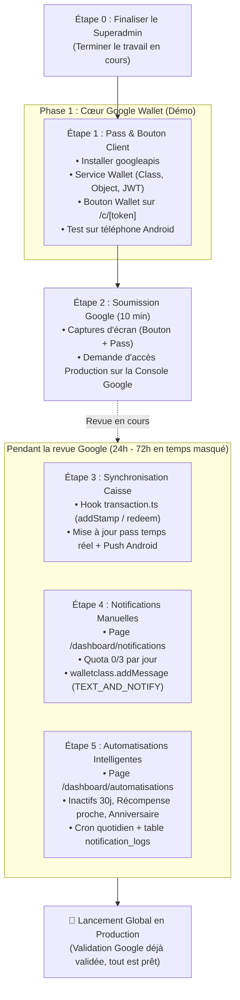

# Plan d'Architecture & d'Implémentation : Google Wallet, Notifications Push & Automatisations

> **Document unique de référence** consolidant l'ensemble des spécifications, maquettes (`loyalty-planning/wallet`), modèles de données et stratégie de déploiement pour Walaa.

---

## 1. Réponse Stratégique : Quand et Comment faire la Validation Google ?

### 1.1 Quand soumettre la validation à Google ?

> [!IMPORTANT] **Recommandation forte : Soumettre la validation le plus TÔT possible, dès la fin de l'Étape 1 (Pass Démo + Bouton).**
>
> **Pourquoi maintenant et pas à la fin ?**
>
> 1. **Délai de revue (24h à 72h) :** L'équipe Google prend entre 1 et 3 jours ouvrés pour valider un compte. Si vous attendez d'avoir tout développé, vous serez bloqué à la fin à attendre Google.
> 2. **Ce que Google inspecte réellement :** Google ne vérifie **QUE** 2 choses :
>    - Que le bouton sur votre page web respecte leur charte graphique (_"Ajouter à Google Wallet"_).
>    - Que le pass affiché sur le téléphone a un logo d'enseigne propre et un QR code valide. Google **ne regarde pas** et n'a pas accès à votre tableau de bord commerçant, vos automatisations ou votre superadmin.
> 3. **Travail en temps masqué :** En soumettant la validation dès que le pass s'affiche sur votre téléphone, le délai de 72h s'écoule en arrière-plan pendant que nous développons la synchronisation caisse, les notifications manuelles et les automatisations. Au moment où ces fonctionnalités sont terminées, la validation Google est déjà acquise !

### 1.2 Faut-il refaire valider par Google après l'ajout de nouvelles fonctionnalités ?

- **NON, jamais.**
- L'approbation Google est accordée au niveau de l'**Issuer ID (`3388000000023206839`)**.
- Dès que Google active la Production, vous avez un accès permanent et illimité à l'API. Vous pouvez ajouter des notifications push, des automatisations ou de nouveaux champs instantanément sans aucune re-validation.

---

## 2. Déroulé des Étapes d'Exécution (Roadmap Recommandée)



---

## 3. Analyse des Maquettes Validées (`loyalty-planning/wallet`)

### 3.1 Carte Client (`/c/[token]`) & Boutons Wallet

_D'après `gofullpage-fidelix-ma-card-...png` :_

1. **Bannière d'opt-in aux notifications :**
   - Bloc sombre contrasté : _"NOTIFICATIONS : NE RATEZ AUCUNE OFFRE"_
   - Texte : _"Promotions, récompenses débloquées, invitations : recevez tout directement sur votre téléphone."_
   - Bouton CTA : `[ Activer les notifications ]` (Web Push).
2. **Section "AJOUTER À VOTRE WALLET" :**
   - **Bouton Apple Wallet :** Bouton noir aux coins arrondis _"Ajouter à Apple Wallet"_ avec logo Apple (préparé pour la phase Apple Wallet).
   - **Bouton Google Wallet :** Bouton officiel avec logo Google Wallet et bordure/texte adaptés au thème de l'enseigne.
3. **Sections complémentaires :**
   - Bloc "Mon Compte" (Code client, date d'adhésion).
   - Bloc "Parrainage : Invitez un ami" (Partage de lien unique).

---

### 3.2 Dashboard Commerçant : Notifications Push Manuelles (`/dashboard/notifications`)

_D'après `gofullpage-fidelix-ma-notifications-...png` :_

- **Quota anti-spam journalier :** Badge `0/3 aujourd'hui` (_"Jusqu'à 3 notifications par jour. Au-delà, les clients se lassent et suppriment leur carte"_).
- **Formulaire d'envoi :**
  - **Titre (0/50 caractères) :** ex. _"Offre spéciale ce weekend !"_
  - **Message (0/150 caractères) :** ex. _"Profitez de -20% sur votre prochaine visite. Valable jusqu'au 30 juin."_
  - **Lien optionnel :** ex. `https://votre-site.ma/offre`.
- **Avertissement de modération :** Règles anti-spam et contenu pro.
- **Diffusion Google Wallet :** Appel API `LoyaltyClass.addMessage` avec `messageType: "TEXT_AND_NOTIFY"`. Déclenche une **notification native système Android** réveillant le smartphone du client et ouvrant directement le pass Google Wallet.
- **Historique :** Liste des notifications envoyées (Date, Titre, Destinataires, Statut).

---

### 3.3 Dashboard Commerçant : Automatisations Intelligentes (`/dashboard/automatisations`)

_D'après `gofullpage-fidelix-ma-automations-...png` :_ Trois déclencheurs programmés pour stimuler le retour des clients sans effort :

1. **Relance client inactif (Win-back) :**
   - Switch On/Off.
   - Message personnalisable : _"Cela fait un moment ! Revenez profiter de vos avantages fidélité. 😊"_
   - Déclencheur paramétrable : _"Après [ 30 ] jours sans visite"_.
2. **Bientôt une récompense (Proximity reward) :**
   - Switch On/Off.
   - Déclencheur paramétrable : _"Notifier quand il reste [ 20 ] points (ou X tampons) avant la récompense"_.
3. **Anniversaire :**
   - Switch On/Off.
   - Message personnalisable : _"Joyeux anniversaire ! Une attention vous attend chez nous. 🎂"_
   - Déclencheur : _"Envoyer [ 0 ] jour même"_ (avec date d'anniversaire facultative collectée sur `/j/[slug]`).

- **Protection stricte :** Vérification via la table `notification_logs` : un client n'est jamais contacté deux fois pour le même événement.

---

## 4. Modèle de Données (Drizzle Schema)

Tables à ajouter dans `src/db/schema/loyalty.ts` :

```typescript
// 1. Configuration des automatisations par commerce
export const automations = pgTable("automations", {
  id: text("id").primaryKey(),
  organizationId: text("organization_id")
    .notNull()
    .references(() => organization.id, { onDelete: "cascade" }),
  type: text("type").notNull(), // 'inactive_client' | 'reward_proximity' | 'birthday'
  isEnabled: boolean("is_enabled").default(false).notNull(),
  message: text("message").notNull(),
  triggerValue: integer("trigger_value").notNull(), // ex: 30 jours ou 20 points
  createdAt: timestamp("created_at").defaultNow().notNull(),
  updatedAt: timestamp("updated_at").defaultNow().notNull(),
});

// 2. Historique des notifications manuelles et automatiques
export const notifications = pgTable("notifications", {
  id: text("id").primaryKey(),
  organizationId: text("organization_id")
    .notNull()
    .references(() => organization.id, { onDelete: "cascade" }),
  title: text("title").notNull(),
  message: text("message").notNull(),
  actionUrl: text("action_url"),
  type: text("type").default("manual").notNull(), // 'manual' | 'automation'
  channel: text("channel").default("all").notNull(), // 'wallet' | 'webpush' | 'all'
  recipientCount: integer("recipient_count").default(0).notNull(),
  sentAt: timestamp("sent_at").defaultNow().notNull(),
});

// 3. Journal d'envoi par client (garde anti-doublon)
export const notificationLogs = pgTable("notification_logs", {
  id: text("id").primaryKey(),
  customerId: text("customer_id")
    .notNull()
    .references(() => customers.id, { onDelete: "cascade" }),
  automationType: text("automation_type").notNull(),
  sentAt: timestamp("sent_at").defaultNow().notNull(),
});
```

---

## 5. Détail Technique des Appels API Google Wallet

### Envoi Push Broadcast à tous les porteurs de la carte :

```typescript
await walletClient.loyaltyclass.addMessage({
  resourceId: `${ISSUER_ID}.program_${programId}`,
  requestBody: {
    message: {
      header: title,
      body: messageText,
      actionUrl: linkUrl ? { url: linkUrl } : undefined,
      messageType: "TEXT_AND_NOTIFY", // Déclenche la notification push native Android !
      displayInterval: {
        start: { date: new Date().toISOString() },
        end: { date: new Date(Date.now() + 7 * 86400000).toISOString() },
      },
    },
  },
});
```

### Envoi Push Ciblé Client Unique (Automatisations / Récompense) :

```typescript
await walletClient.loyaltyobject.addMessage({
  resourceId: `${ISSUER_ID}.card_${cardId}`,
  requestBody: {
    message: {
      header: "Bientôt votre cadeau !",
      body: "Plus que 2 tampons pour obtenir votre café offert ☕",
      messageType: "TEXT_AND_NOTIFY",
    },
  },
});
```

---

## 6. Synthèse & Plan d'Action Immédiat

1. **Priorité 1 :** Finaliser le travail en cours sur le **superadmin**.
2. **Priorité 2 :** Dès que le superadmin est prêt, exécuter **l'Étape 1** (création du pass + bouton).
3. **Priorité 3 :** Soumettre immédiatement la demande d'accès production à Google (Étape 2).
4. **Priorité 4 :** Développer la synchronisation caisse, les notifications et les automatisations pendant les 2-3 jours de revue Google.
